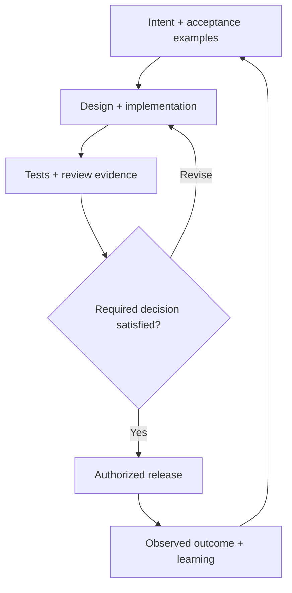

# AI-Native SDLC Skills

**Reusable Agent Skills for taking a software change from intent to evidence.**

Created by Vishal Shah. General-purpose workflows with a ServiceNow adaptation and synthetic examples. Independent, original implementation inspired by Anthropic's AI-native SDLC playbook; not an official Anthropic, OpenAI or ServiceNow product.

## What you get

|Skill|Use it to|Output|
|---|---|---|
|`ai-native-sdlc-skills`|Choose and connect the appropriate stages|Linked delivery workflow|
|`sdlc-plan`|Clarify a problem, scope and expected outcome|`intent.md`|
|`sdlc-design`|Design against accepted requirements and real constraints|`spec.md`|
|`sdlc-build`|Plan and implement a small, verifiable change|`plan.md` + actual change|
|`sdlc-test`|Check behavior against independent expectations|`test-evidence.md`|
|`sdlc-deploy`|Prepare a release review, rollback and monitoring decision|`release.md`|
|`sdlc-maintain`|Turn observed outcomes into a regression or new intent|`lessons.md`|



## Install into a project

Requires Python 3.10+; no Python packages or API keys are needed. Review the skills before installing. Commands work in a Windows terminal with `python` installed, and in macOS/Linux terminals with the appropriate Python command.

```shell
git clone https://github.com/vishal8shah/ai-native-sdlc-skills.git
cd ai-native-sdlc-skills

# Preview the changes. The destination project must already exist.
python scripts/install.py --client claude --project ../my-project

# Apply after reviewing the plan.
python scripts/install.py --client claude --project ../my-project --apply

# Codex local project skills:
python scripts/install.py --client codex --project ../my-project --apply
```

Claude Code project skills use `.claude/skills`; Codex local project skills use `.agents/skills`. The installer creates new directories and refuses to overwrite existing skills. Use `--only sdlc-plan` to install one stage. The default installs the router and six standalone stage skills; the router also carries its stage resources so it works independently. Product/account availability and enterprise policies still apply. ChatGPT Work and Claude cloud skill management differ from local project discovery; follow their official documentation rather than assuming a Git clone installs a cloud skill.

## Try it

In Claude Code:

```text
/sdlc-plan Read examples/request-validation/request.md and draft a bounded intent. Use synthetic data and preserve unknown platform details.
```

In Codex, select a skill or invoke it explicitly:

```text
Use $sdlc-plan to turn examples/request-validation/request.md into a bounded intent with concrete acceptance examples.
```

For the complete workflow, invoke `ai-native-sdlc-skills`. Supply the real project context and current work records. Review expected outcomes before implementing; record the decisions your actual process requires.

## Local helpers

```shell
# Create draft records in a NEW folder. Existing output is never overwritten.
python scripts/sdlc.py init-run --output ../delivery-demo --title "Request validation" --record-id DEMO-001 --owner "Pilot owner" --profile servicenow

# Capture content digests; this does not change the status or approve anything.
python scripts/sdlc.py snapshot ../delivery-demo --stage plan

# Check structure and content lineage. Drafts are allowed unless explicitly required.
python scripts/sdlc.py check-run ../delivery-demo
python scripts/sdlc.py check-run ../delivery-demo --through test --require-accepted

# Summarize paired pilot measurements. The supplied CSV is SYNTHETIC.
python scripts/sdlc.py measure examples/pilot-measurements.csv --hour-rate 140 --setup-hours 1 --ai-cost 10

# Validate skills, local links and scripts; then run deterministic tests.
python scripts/validate_repo.py
python -m unittest discover -s tests -v
```

See [CLI behavior and limitations](references/cli.md), [delivery record conventions](references/delivery-contract.md) and [ServiceNow adaptation](references/servicenow.md).

## What is enforced

These skills are instructions. The helper checks local structure and hashes. Neither authenticates approvals, enforces production permissions, tests application correctness, or guarantees regulatory compliance. A deployment still uses your permitted tools, actual authorization and organization controls. There are no installed hooks, background jobs, external calls or model charges in this repository.

## Evaluation

`evals/cases.json` contains scenario prompts and reviewer rubrics for behavior evaluation. Unit tests check helper behavior; they do not prove that a model follows a skill. Record the client/model version and actual output when running a scenario. See [evaluation guidance](evals/README.md).

## Contribute

Keep each skill focused, preserve its trigger description and add a realistic evaluation case for meaningful behavior changes. Add a deterministic regression test for script bugs. Use synthetic inputs. Do not upload employer information, customer records, credentials or internal policies.

## License and sources

Original repository content is MIT licensed. External sources remain under their own terms. See [LICENSE](LICENSE) and [ATTRIBUTION.md](ATTRIBUTION.md). No proprietary playbook text or vendor hook examples are bundled.
