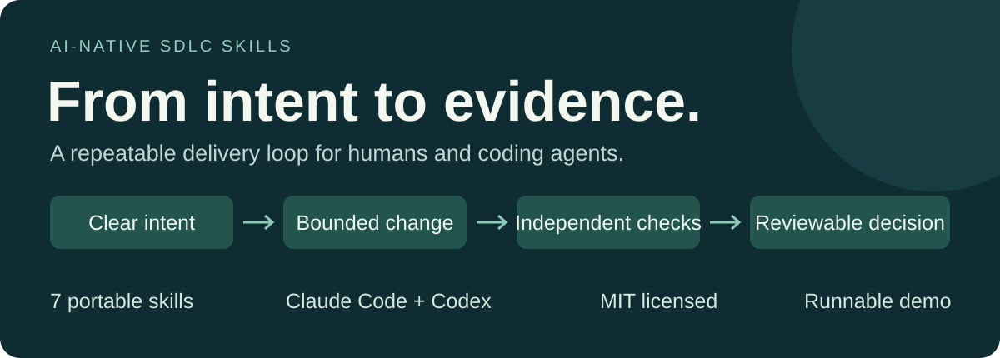
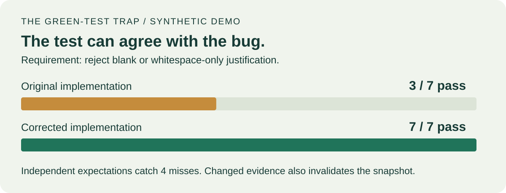
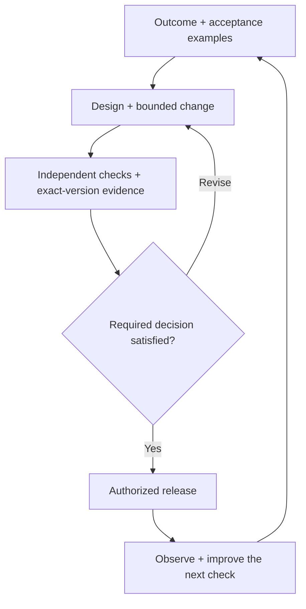

<p align="center"></p>

<p align="center">
<a href="https://github.com/vishal8shah/ai-native-sdlc-skills/actions/workflows/validate.yml"></a>
<a href="LICENSE"></a>


</p>

# Faster code needs a better delivery loop.

**Seven reusable skills for taking an AI-assisted change from a clear problem to evidence someone can inspect.** Use the whole workflow or install one stage. Built for developers, platform leads and delivery teams using Claude Code or Codex local project skills.

**Start with something you can break.** A generated test passes while four acceptance checks fail. Correct the behavior, then change the requirement or the registered source file: the earlier evidence becomes stale. Next, generate a complete six-stage packet with real local test results.

[Run the demo](#try-it-in-about-a-minute) · [Experiment with a complete change](#experiment-with-a-complete-change) · [Install a skill](#install-into-your-project) · [Read the field guide](docs/FIELD_GUIDE.md) · [Inspect the review](docs/REVIEW.md)

## Try it in about a minute

Requires Git and Python 3.10+. The local demo uses only the Python standard library: no API key, AI account or external service is required. Clone time depends on your connection. On systems that name Python `python3`, use that command instead.

```shell
git clone https://github.com/vishal8shah/ai-native-sdlc-skills.git
cd ai-native-sdlc-skills
python scripts/demo.py
```

```text
1. A generated test expects whitespace to be accepted: PASS
   Independent acceptance checks: 3/7 passed; 4 failed

2. Correct the behavior: 7/7 acceptance checks pass

3. Snapshot the evidence, then edit the requirement: STALE RECORD DETECTED

4. Edit registered source or remove registered results: EVIDENCE CHANGE DETECTED
```

These are deterministic results from a tiny synthetic fixture, not a productivity benchmark or a model evaluation.



**Why this matters:** test expectations can repeat the implementation's mistake. Agree the required behavior before implementation, keep the evidence tied to an exact version, and make the next handover reconstructable.

## Experiment with a complete change

```shell
python scripts/worked_example.py --output ../sdlc-worked-example
python scripts/sdlc.py check-run ../sdlc-worked-example --require-accepted
```

This creates six filled delivery records, the tiny implementation, four executed unit-test methods, raw output and a structured result. Six unique evidence files are checked by SHA-256 across the six stages. The script refuses to complete the packet if a required test is missing, skipped or fails.

**Decisions are explicitly simulated.** The unit tests really run; no external approval or deployment happens. Open `release.md` to see the distinction. Edit the implementation and repeat `check-run`: it must fail until the evidence is reviewed and updated. The output folder must be new.

[Follow the experiment, including the expected failure](examples/worked-change/README.md) · [See what the quality evidence establishes](docs/QUALITY_BAR.md)

## The seven skills

|Skill|Use it when you need to…|Working output|
|---|---|---|
|[`ai-native-sdlc-skills`](SKILL.md)|Choose a stage or connect the whole workflow|Linked evidence and next decision|
|[`sdlc-plan`](skills/sdlc-plan/SKILL.md)|Clarify the user problem, scope and acceptance examples|`intent.md`|
|[`sdlc-design`](skills/sdlc-design/SKILL.md)|Compare options against real architecture and constraints|`spec.md`|
|[`sdlc-build`](skills/sdlc-build/SKILL.md)|Plan and implement a bounded configuration/code change|`plan.md` + actual change|
|[`sdlc-test`](skills/sdlc-test/SKILL.md)|Check behavior against independently agreed expectations|`test-evidence.md`|
|[`sdlc-deploy`](skills/sdlc-deploy/SKILL.md)|Prepare findings, release evidence, rollback and monitoring|`release.md`|
|[`sdlc-maintain`](skills/sdlc-maintain/SKILL.md)|Turn observations into a regression case or next intent|`lessons.md`|

Each stage is self-contained, includes its output template and loads only when relevant. The router reads the stage it needs. No hooks, production credentials, background jobs or model API integrations are installed.



## Install into your project

Local project discovery is supported by the documented Claude Code and Codex skill locations. Their clients must be separately installed, signed in and permitted by your organization. Client/model behavior has not been certified by this repository. ChatGPT Work and Claude cloud skill management have different installation flows; follow their official documentation in [ATTRIBUTION.md](ATTRIBUTION.md).

From the cloned repository, create a separate sandbox project and preview an installation:

```shell
mkdir ../sdlc-sandbox
python scripts/install.py --client claude --project ../sdlc-sandbox
python scripts/install.py --client claude --project ../sdlc-sandbox --apply
cd ../sdlc-sandbox
claude
```

Then run this in that **destination project**. The complete synthetic input is in the prompt, so it does not depend on an examples folder elsewhere:

```text
/sdlc-plan Create intent.md for a development-only request form that must reject empty and whitespace-only justification. Use synthetic data. Preserve valid requests. Exclude production, integrations, access changes and approval-policy changes. Actual platform field names are unknown.
```

For Codex, use `--client codex` when installing, launch `codex` in the destination project, then use:

```text
Use $sdlc-plan to create intent.md for a development-only request form that rejects empty and whitespace-only justification. Preserve valid requests. Use synthetic data and keep missing platform details explicit.
```

Want just one skill? Add `--only sdlc-test` or another name from the table. The default installs the router plus six standalone skills. The router carries its own stage resources so it can also be installed alone.

The installer previews by default, refuses existing skill destinations, stages copies before publication and rolls back its own new skill folders if installation fails. It copies runtime tools, not repository-only validation/demo tooling. See the [CLI reference](references/cli.md).

## Evidence you can inspect

|Check|What it establishes|What it does not establish|
|---|---|---|
|Repository validation|Skill/UI metadata schemas, local file links, evaluation schema and Python syntax|That a model follows the skills|
|Helper tests|Covered behavior of installation, measurement, record structure and freshness checks|Application correctness or production security|
|Runnable demo and worked change|Specified synthetic failures; real local unit execution; complete teaching records with verified local attachments|Real approvals, deployment, productivity or broad defect detection|
|Seven captured skill trials|Original tasks, complete responses, inspected-source hashes and author observations for every shipped skill|A benchmark, independent assurance or cross-client certification|
|GitHub Actions|The workflow's actual result on its configured OS/Python matrix|Successful execution of every target AI client|

```shell
python scripts/validate_repo.py
python -m unittest discover -s tests -v
python scripts/demo.py --json
python scripts/worked_example.py
python scripts/trials.py verify --require-current
```

The CI matrix includes Ubuntu with Python 3.10 and 3.13, Windows with Python 3.13, and macOS with Python 3.13. [Inspect the current runs](https://github.com/vishal8shah/ai-native-sdlc-skills/actions/workflows/validate.yml). See [the self-review](docs/REVIEW.md) for false passes found and fixed.

To repeat a skill task in your own client, [read the trial method](evals/recorded/README.md), then emit just its input:

```shell
python scripts/trials.py prompt DEMO-301 --client codex
```

Paste that prompt into a fresh context in the project where you installed the skills. Keep the recorded response and author observations away from the assistant until after the run. The original runner's exact model deployment identifier was unavailable; the packets disclose that limit.

## Work with real delivery records

```shell
python scripts/sdlc.py init-run --output ../delivery-demo --title "Request validation" --record-id DEMO-001 --owner "Pilot owner" --profile servicenow
python scripts/sdlc.py snapshot ../delivery-demo --stage plan
python scripts/sdlc.py check-run ../delivery-demo --through plan
```

Initialization creates drafts. A structurally valid draft is not an accepted change. Follow the complete [draft → review → recorded acceptance walkthrough](docs/WALKTHROUGH.md), including the required evidence and decision object. Keep existing work/change systems authoritative where your team requires them.

Register a real local evidence file with `attach-evidence` before snapshotting. A plain URL or reference string is recorded but **not fetched or verified**. Local hash checks detect changed bytes; they do not establish correct behavior or authenticated approval.

For ServiceNow, verify the actual instance, application scope, components and transport route. The [adaptation](references/servicenow.md) includes non-production ATF and alternative-submission considerations. There is no ServiceNow connector in this project.

## Measure the whole outcome

The supplied CSV is **synthetic**. Replace it with matched observations before drawing any conclusion:

```shell
python scripts/sdlc.py measure examples/pilot-measurements.csv --hour-rate 140 --setup-hours 1 --ai-cost 10
```

Measure elapsed time, staff effort, rework, defects, setup and AI spend separately. A small observational pilot is directional; recovered capacity is not automatically cash saved. The helper keeps negative savings visible.

## The community target

**Help 100 teams run one reproducible pilot each.** This is an ambition, not an adoption count. Start with one bounded change. Share a redacted or synthetic write-up with scope, method, sample size, quality outcomes, costs and limitations. Useful failures count as progress.

Use the [pilot report template](docs/PILOT_REPORT_TEMPLATE.md), [contribution guide](CONTRIBUTING.md) and [launch copy](docs/LAUNCH.md). A star helps discovery; a reproducible account helps the next team make a better decision.

## Boundaries and attribution

Skills are instructions. Local records, hashes and agent reviews do not authenticate approvals, grant access, enforce deployment rights or guarantee compliance. Apply the controls of your actual environment.

Created by **Vishal Shah**. An independent, original implementation inspired by [Anthropic's AI-native SDLC playbook](https://claude.com/resources/articles/the-ai-native-sdlc-playbook). Not affiliated with or endorsed by Anthropic, OpenAI or ServiceNow. Original contributions are [MIT licensed](LICENSE); linked third-party sources retain their own terms. [Sources](ATTRIBUTION.md) · [Security reporting](SECURITY.md)
