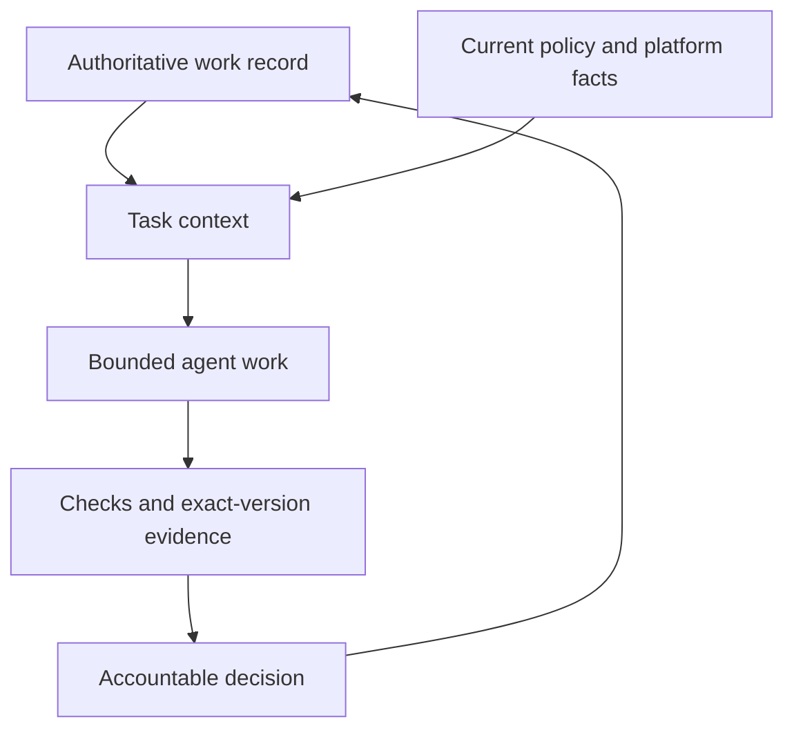
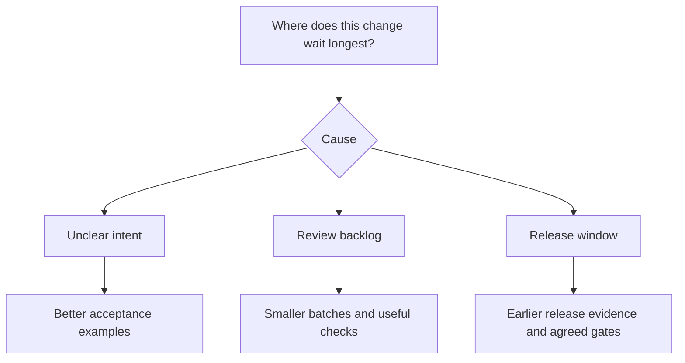

# The field guide: make the next handover inspectable

The useful question is whether the next person or agent can reconstruct the job from its evidence. This guide is an original application framework, informed by the source material in [ATTRIBUTION.md](../ATTRIBUTION.md). Its rollout targets and examples are recommendations, not measured productivity claims.

## The operating model

|Keep stable|Make explicit|Why it matters|
|---|---|---|
|The outcome|Concrete acceptance examples|A plausible implementation can solve the wrong problem|
|The source of truth|One authoritative record per artifact|Competing copies can disagree about what was decided|
|The action boundary|Permitted environment, tools and scope|An instruction alone cannot enforce access|
|The handover|Version, evidence, owner and next decision|A fresh session can continue without the previous chat|
|The feedback|Observed failure and a targeted regression|Repeated mistakes should change the process|

## A test can be green for the wrong reason

The [runnable demo](../scripts/demo.py) uses seven independently stated acceptance fixtures. The intentionally wrong implementation treats any truthy value as valid. Its misleading generated test expects whitespace to succeed, so that test passes. The independent expectations reject whitespace and non-string input, exposing four misses. The corrected implementation passes those seven cases.

This proves only those synthetic cases. In a real application, the expected behavior, fixtures and access/failure paths need an appropriate reviewer. A second model can add useful findings but does not create independent organizational assurance by itself.

## Separate four kinds of context

|Mechanism|Use for|Example|
|---|---|---|
|Task prompt|This outcome and this scope|Fix one request validation path|
|Project facts|Architecture, commands and known conventions|Verified test action and application scope|
|Skill|A repeatable procedure|Map requirements to tests and report gaps|
|Enforced control|Actions that must be prevented or gated|A protected release route and scoped credentials|

Keep each layer small and current. A skill can remind an agent to comply; enforcement belongs to validated tooling and access controls. A shell hook whose condition misses a path is not a complete production boundary.

## Find the actual constraint

Faster implementation may move the queue into requirements, review or release windows. Measure each stage's active duration and waiting separately. For overlapping work, use the critical path rather than adding all durations. Staff effort is another measure: include supervision, review, fixing and setup.

Do not add concurrency simply because agents can produce more. Raise work in progress only while review, integration and quality keep up.

## An ambitious first month

These are suggested experiment milestones, not scheduled tasks or an established success rate.

|Period|Deliverable|Decision evidence|
|---|---|---|
|Days 1–3|One change type, baseline, reviewer and accepted examples|Scope is bounded and outcomes can be checked|
|Days 4–7|One manually supervised end-to-end change|Actual failures, review corrections and elapsed/staff time|
|Week 2|Repeated comparable changes|Matched measurements; unrun checks and confounders recorded|
|Week 3|One targeted automation of the observed bottleneck|Observed reduction in waiting or effort without worse quality|
|Week 4|A reproducible pilot write-up|Sample size, quality, costs, limitations and the next experiment|

A longer sample can still be biased. Consider task difficulty, reviewer availability, learning effects, release timing and the observation window for defects. Do not extrapolate annual savings from one successful example.

## Apply it to a platform team

For ServiceNow, keep the real work/change record authoritative according to your team's rules. Verify the instance release, scope, fields and existing configuration before naming an implementation. Link the actual version or transport reference. Run ATF only in non-production. See [the adaptation](../references/servicenow.md).

The same procedure applies to an API, an internal tool or an infrastructure change, but each needs its own expected behavior, permission boundary and verification method.

## Decide how to expand

Expand a supervised experiment when the observed evidence is encouraging and the necessary controls are approved. Rework it when review/rework rises, quality declines or setup overwhelms capacity recovered. A production or access issue calls for investigation according to the real incident process.

The project's community ambition is 100 teams running one reproducible pilot each. Useful negative results belong in that record. A clear failure and an honest limitation can help another team more than a dramatic percentage without a denominator.
