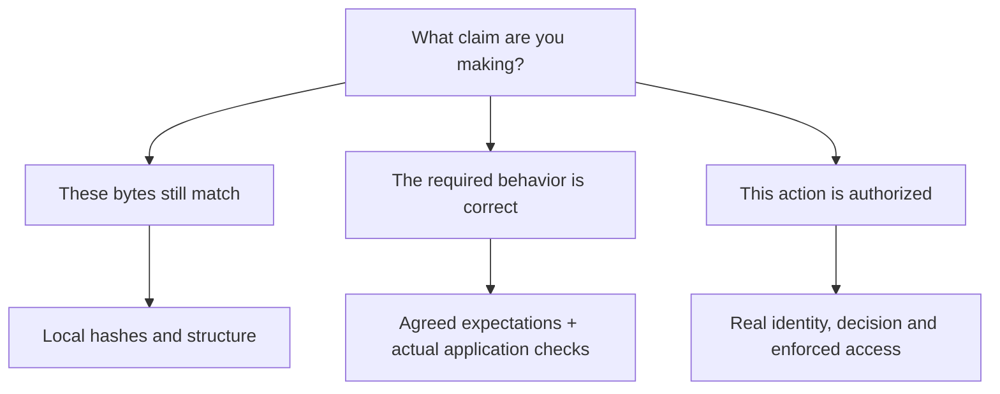

# What would make this useful enough to trust with a pilot?

The target is a reproducible delivery toolkit: useful work within the supplied authority, clear expected behavior, inspectable results, and a next decision someone can reconstruct. More files or a larger test count alone do not establish that target.

## The current evidence

|Question|Evidence supplied|Important limit|
|---|---|---|
|Can a newcomer try it without buying anything?|Standard-library demo and complete worked example|The examples are synthetic and local|
|Can it catch a green test with the wrong expectation?|Runnable seven-case fixture and a captured test-skill response|Covered cases do not estimate broad defect detection|
|Can it complete authorized useful work?|Captured build response with actual code and unit tests; portable blueprint reruns them|One tiny function, one task runner; no native-client discovery|
|Can a handover become visibly stale?|Artifact/upstream snapshots plus registered local-file hashes|Local records can be rewritten; hashes do not authenticate intent or authority|
|Does it separate evidence from assertions?|Local verified-file counts, explicit unverified references, synthetic mode|External records and decision makers are not queried|
|Can a reader inspect the task-trial claims?|Seven input/output packets, source hashes, provenance and author observations|Exact model deployment ID unavailable; author review is not independent assurance|
|Does the tooling travel across platforms?|Four configured OS/Python CI jobs|Read the actual commit's Actions result; target AI clients are separate|

## Three questions a green result cannot answer alone

A local hash check answers the first question within its scope. A passing unit test addresses specified behavior in its tested context. Neither creates the actual authority to release. Good evidence names the claim it supports.

## Use it efficiently

1. **Spend a few minutes breaking the local example.** Learn what the checker detects and what it does not.
2. **Pick one repeatable change type.** Use one skill at the current bottleneck before adding the whole workflow.
3. **Agree concrete acceptance examples first.** Include missing data, wrong type, alternate submission paths and applicable failure behavior.
4. **Retain the actual candidate and results.** Link external records, attach local evidence by hash, and state unrun checks.
5. **Measure the whole delivery loop.** Include review, waiting, rework, setup and AI cost; report defects separately from speed.
6. **Expand after repeated useful outcomes.** Keep failures and confounders visible. Use the [pilot template](PILOT_REPORT_TEMPLATE.md).

## Ambitious next evidence targets

These are proposed targets, not completed results or schedules.

|Target|What would improve the evidence|What would still be limited|
|---|---|---|
|Native-client first use|Repeat install/discovery/invocation in actual Claude Code and Codex versions with full traces|Other versions, policies and environments|
|Broader behavior coverage|Several successful and failure tasks per skill, including existing authorization, ambiguous evidence and adversarial inputs|Selected tasks remain a sample|
|Repeatability across models|Predeclare criteria; repeat fresh tasks; retain all attempts and model IDs where exposed|Comparisons depend on task mix and evaluator agreement|
|Platform adaptation|A supervised non-production ServiceNow pilot with actual configuration and transport references|Other instances and production conditions|
|Real delivery value|Matched before/after observations of effort, elapsed time, quality and costs|Observational data can be confounded; capacity is not automatic cash savings|
|Community usefulness|100 teams publish one reproducible, redacted or synthetic pilot account each|This is an ambition, not adoption or a promise of reach|

The current version is a starting point for a supervised pilot. It does not establish universal quality, production fitness, model accuracy, cost savings or virality. The [self-review](REVIEW.md) records concrete failures found and fixed so the claims can improve with the evidence.
