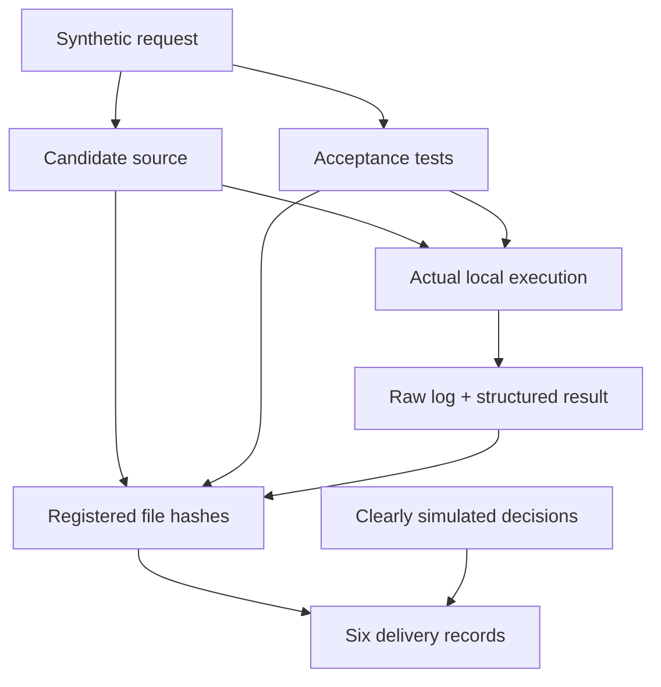
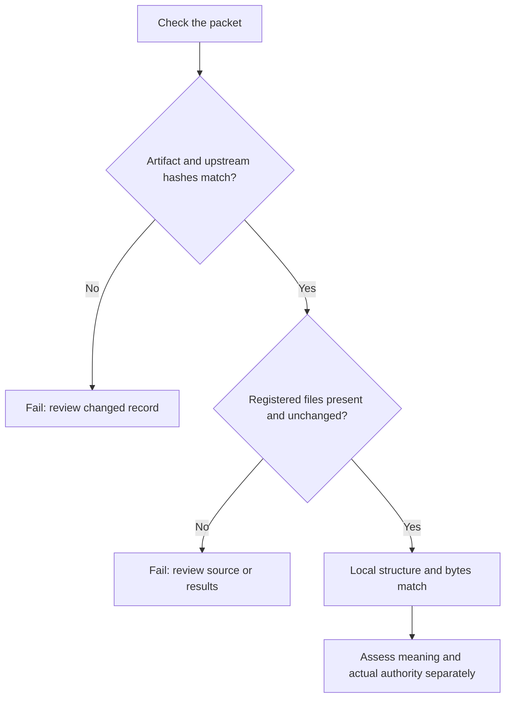

# Run it. Inspect it. Change a file. Watch the check fail.

This example turns a tiny request validator into a complete six-stage delivery packet. It separates **real local execution** from **simulated decisions**. You can use it without an AI account, API key or external service.

## Generate the packet

From the repository root, with Python 3.10+:

```shell
python scripts/worked_example.py --output ../sdlc-worked-example
python scripts/sdlc.py check-run ../sdlc-worked-example --require-accepted
```

Use a new output folder; existing folders are refused. To execute without retaining files, omit `--output`.

The function and four unit-test methods came from the [captured authorized-build trial](../../evals/recorded/DEMO-301/response.md). The script copies that code from [blueprint](blueprint), runs the tests again in your environment and retains the actual output. The scenario is synthetic; these are unit cases for one small function, not broad validation of an application.

|Input|Expected result|Reason|
|---|---|---|
|Argument omitted or `None`|`False`|Justification is missing|
|Empty string or Python whitespace only|`False`|No non-whitespace content|
|Nonblank string|`True`|The supplied acceptance rule is met|
|Non-string value|`False`|The function accepts text only|

Whitespace means Python's `str.strip()` behavior. This does not cover every Unicode string a person might perceive as visually blank.

## What is inside

|Path in the generated folder|What to inspect|
|---|---|
|`inputs/request.md`|The expected behavior, stated before implementation|
|`implementation/request_validation.py`|The actual candidate function|
|`implementation/test_request_validation.py`|Four methods covering the four acceptance groups|
|`evidence/unittest.txt`|Real test output from this execution|
|`evidence/test-report.json`|Executed method IDs, failures, errors, skips and verification result|
|`evidence/execution.json`|Actual command, Python version, timestamp and exit code|
|`intent.md`, `spec.md`, `plan.md`|Why, design and actual change|
|`test-evidence.md`, `release.md`, `lessons.md`|Observed checks, explicit non-execution of deployment and next learning|
|`run.json`|Statuses, SHA-256 snapshots, typed attachments and clearly simulated decision references|



Expected result: `valid: true`, `record_mode: synthetic`, actual test exit code `0`, **six unique local files** verified and **36 attachment references** checked across six stages. Thirty-six references are six stages reusing the same six evidence files; they are not 36 independent tests.

The generator requires all four named test methods to execute successfully. Missing, skipped, failed, expected-failure or unexpected-success tests refuse completion. Drafts and actual failure logs remain available when an output folder was requested. A zero process exit code alone is insufficient.

## Break the freshness check

Append a harmless comment to the generated implementation. This changes its bytes without changing the function's behavior:

```shell
python -c "from pathlib import Path; p=Path('../sdlc-worked-example/implementation/request_validation.py'); p.write_text(p.read_text(encoding='utf-8') + '\n# Evidence freshness experiment\n', encoding='utf-8')"
python scripts/sdlc.py check-run ../sdlc-worked-example --require-accepted
```

**Expected failure:** a nonzero exit status and `Local evidence changed` findings. A harmless comment is enough because the check asks whether the exact registered bytes still match. It does not interpret whether the code change matters.

Try deleting a result file or editing an earlier Markdown artifact. The next check must also fail. To start clean, generate into a different new folder. For a working record, follow the actual [reopen, review and update process](../../docs/WALKTHROUGH.md); repeatedly replacing hashes is not evidence that new tests or decisions occurred.



## What you may conclude

You executed these unit tests against these bytes, retained their result, and exercised local freshness checks. You did not run a native AI client, obtain an organizational approval, deploy a service, test ServiceNow, measure productivity or authenticate a decision maker. Every accepted status in this example is teaching metadata. `release.md` explicitly states **Execution: NOT EXECUTED**.

For your first real pilot, replace the input with one bounded work item, define acceptance examples with the appropriate owner, run actual application checks and keep real decisions in the authoritative system. Use the skills to prepare useful evidence and handovers.
